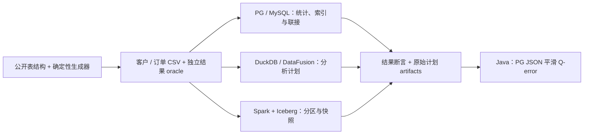

# 执行计划：从 OLTP 到分析引擎、数据湖与湖仓一体

以固定版本源码、公开表结构、可复现实验研究 **Execution Plan（执行计划）**：解释优化器为什么这样选择，再用实际行数、结果断言和原始计划验证。

本地不编译；源码构建、引擎运行和实验验收放在 GitHub Actions。`oatp` 按 OLTP（Online Transaction Processing，在线事务处理）理解。
原始笔记完整保留在 [original-notes.md](docs/original-notes.md)，其中简化表述以新章节的限定和纠正为准。

## 阅读顺序

1. [优化器与执行器：K1–K8](docs/01-optimizer-and-execution.md)：逻辑重写、基数估计、成本、索引、联接、向量化、分布式与湖表。
2. [五种 RDBMS 的版本、入口与陷阱](docs/02-vendor-plans.md)：MySQL、PostgreSQL、Oracle、SQL Server、Db2。
3. [可复现实验 E1–E6](docs/03-experiments.md)：数据、断言、构建范围、产物与未覆盖内容。
4. [固定版本源码路线](docs/04-source-map.md)：从 SQL 到优化器、执行器和存储层。
5. [书籍、论文、官方文档及双语术语](docs/05-references.md)：每章的 B/P/D 引用可在这里定位。
6. [数据来源与生成规则](data/README.md)、[交付与 CI 证据](docs/06-delivery.md)。
7. [PostgreSQL 真实计划案例](docs/07-postgres-observed-case.md)：热点顺扫、冷点索引、200 倍估计误差及原始 JSON。
8. [Iceberg 真实快照与 AQE 案例](docs/08-iceberg-observed-case.md)：源码 jar、24 个文件、历史读取及最终执行计划。

## 软件与版本

| 类别 | 官方开源 submodule | 固定版本 | 独立工作流 |
|---|---|---|---|
| 主流关系数据库 / OLTP | [PostgreSQL](https://github.com/postgres/postgres) | 17.6 / REL_17_6 | [postgres.yml](.github/workflows/postgres.yml) |
| 主流关系数据库 / OLTP | [MySQL](https://github.com/mysql/mysql-server) | 8.4.6 / mysql-8.4.6 | [mysql.yml](.github/workflows/mysql.yml) |
| 嵌入式 OLAP / 数仓查询 | [DuckDB](https://github.com/duckdb/duckdb) | 1.3.2 | [duckdb.yml](.github/workflows/duckdb.yml) |
| 列式分析 / 数仓构件 | [Apache DataFusion](https://github.com/apache/datafusion) | 49.0.2 | [datafusion.yml](.github/workflows/datafusion.yml) |
| 数据湖 / 湖仓一体表格式 | [Apache Iceberg](https://github.com/apache/iceberg) | 1.9.2 | [iceberg.yml](.github/workflows/iceberg.yml) |
| 本项目计划诊断器 | Java `plan-audit` | 1.0.0 / JDK 17 | [java-plan-audit.yml](.github/workflows/java-plan-audit.yml) |

这些是代表性项目，不是生态全集。DuckDB、DataFusion 是分析执行引擎，Iceberg 是表格式；不把它们全部叫成完整企业数据仓库。
Oracle、SQL Server、Db2 保留专业讲解，没有官方完整开源内核可添加。完整 gitlink SHA 保存在 [versions.lock.json](versions.lock.json)，不跟随 main 漂移。

## 同一数据、不同机制

采用 [TPC-H 公开 CUSTOMER / ORDERS 表结构](https://www.tpc.org/tpc_documents_current_versions/current_specifications5.asp) 的精简子集，生成固定 1,001 个客户与 100,000 条订单，热点客户占 90%。
这是自定义合成教学数据，**不是官方 TPC-H 数据生成器分布或认证基准**。



实验研究热点/冷点、索引前后、函数谓词与范围谓词、过滤联接聚合、Parquet 裁剪、Iceberg 历史快照。
不预设加索引更快，不硬编码计划形状，不把共享 runner 上单次耗时包装成产品性能排名。

## 使用 GitHub Actions

```powershell
gh workflow run postgres.yml
gh run list --limit 20
gh run view <RUN_ID> --log-failed
gh run download <RUN_ID> --dir artifacts/<RUN_ID>
```

每软件一份 YAML，按路径触发，也支持手动运行。各工作流编译固定源码，并实际运行其产物；Iceberg 为源码 runtime jar + 发行版 Spark 3.5.6。
Java 工具使用 Maven 多模块为主，同源 Gradle 8.14.3 构建；父 POM 明确 `maven.compiler.release=17`。
本项目编译方法在 Actions YAML/`ci/` 中可审阅，不要求本地先编译。

## 三个先纠正的误区

* 顺序扫描、filesort、Nested Loop 都不是脱离规模与分布即可判错的标记。
* MySQL 与 PostgreSQL 的 `EXPLAIN ANALYZE` 都会实际执行；普通 EXPLAIN 的估算不等于运行统计。
* PG 17 实际行数是每循环平均值；节点总时间也不能简单相加。成本单位不能跨产品比较。

项目质量依赖源码、引用与可复现实验支撑；理论覆盖、构建成功、结果正确、性能证明是不同验收层次。
