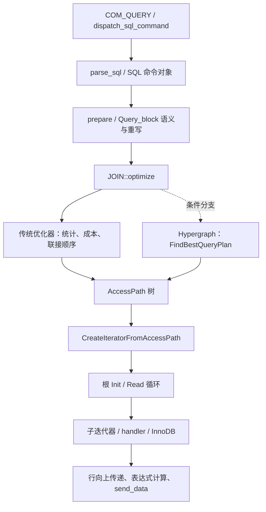

# MySQL 复杂查询的计划生成与执行：源码讲解及日志验证计划

# 数据库面试题：SQL 执行计划如何生成？如何执行？

这是数据库内核、MySQL、PostgreSQL、Oracle，以及数据库研发岗位的经典面试题。

核心答案：SQL 执行计划由查询优化器（Query Optimizer）生成，由执行引擎（Execution Engine）执行。

但是，面试官真正想考察的是：

1. SQL 如何从字符串变成执行计划？
2. 优化器如何选择索引、JOIN 顺序和 JOIN 算法？
3. 什么是逻辑执行计划、物理执行计划？
4. 数据库如何估算执行计划的成本？
5. 执行器如何执行一棵执行计划树？
6. Volcano Iterator 模型是什么？
7. MySQL、PostgreSQL 的执行机制有什么区别？
8. 为什么优化器生成的执行计划有时不是最优的？

下面按照数据库内核研发面试的深度讲解。

---

# 一、SQL 从输入到执行的完整流程

假设数据库有两张表：

```sql
CREATE TABLE users (
    id BIGINT PRIMARY KEY,
    name VARCHAR(100),
    age INT,
    INDEX idx_age(age)
);

CREATE TABLE orders (
    id BIGINT PRIMARY KEY,
    user_id BIGINT,
    amount DECIMAL(10,2),
    INDEX idx_user_id(user_id)
);
```

执行 SQL：

```sql
SELECT
    u.name,
    SUM(o.amount) AS total_amount
FROM users u
JOIN orders o ON u.id = o.user_id
WHERE u.age > 25
GROUP BY u.id, u.name
ORDER BY total_amount DESC
LIMIT 10;
```

数据库内部的典型处理流程：

```text
                 SQL
                  |
                  v
        +-------------------+
        | 1. Parser        |
        | SQL 词法/语法分析 |
        +-------------------+
                  |
                  v
        +-------------------+
        | 2. Semantic      |
        | 语义分析/名称绑定 |
        +-------------------+
                  |
                  v
        +-------------------+
        | 3. Logical Plan  |
        | 逻辑执行计划      |
        +-------------------+
                  |
                  v
        +-------------------+
        | 4. Optimizer     |
        | 查询优化器        |
        +-------------------+
                  |
                  v
        +-------------------+
        | 5. Physical Plan |
        | 物理执行计划      |
        +-------------------+
                  |
                  v
        +-------------------+
        | 6. Executor      |
        | 查询执行器        |
        +-------------------+
                  |
                  v
        +-------------------+
        | 7. Storage Engine|
        | 存储引擎          |
        +-------------------+
                  |
                  v
              查询结果
```

注意：这是概念上的分层，不代表每个数据库都严格采用七个独立模块。

例如，MySQL 的优化器和执行器实现与 PostgreSQL 不完全相同。

---

# 二、执行计划如何生成？

## 1. SQL 解析：Parser

首先，数据库将 SQL 字符串转换为抽象语法树（AST）。

SQL：

```sql
SELECT id, name
FROM users
WHERE age > 25;
```

解析后的 AST 可以抽象为：

```text
SelectStatement
│
├── SelectList
│   ├── Column(id)
│   └── Column(name)
│
├── From
│   └── Table(users)
│
└── Where
    └── GreaterThan
        ├── Column(age)
        └── Constant(25)
```

这个阶段主要进行：

- 词法分析（Lexical Analysis）。
- 语法分析（Syntax Analysis）。
- 构造 AST。

例如：

```sql
SELECT FROM users;
```

会在语法分析阶段报错。

面试重点：AST 不是执行计划。

AST 描述 SQL 的语法结构，而执行计划描述数据库如何获取数据。

## 2. 语义分析：Semantic Analysis

数据库检查：

- 表是否存在。
- 字段是否存在。
- 字段引用是否有歧义。
- 数据类型是否兼容。
- 函数是否合法。
- 聚合语义是否正确。
- 用户是否具有相应权限（具体检查时机因数据库而异）。

例如：

```sql
SELECT salary
FROM users;
```

如果 `users` 没有 `salary` 字段，数据库会报错。

经过语义分析后，数据库能够确定：

```text
users.age
    |
    v
users 表中的 age 列
    |
    v
INT 类型
```

这一步也称为名称绑定（Name Resolution / Binding）。

---

# 三、生成逻辑执行计划

逻辑执行计划（Logical Plan）描述需要执行哪些关系运算，不直接决定具体访问方法。

SQL：

```sql
SELECT name
FROM users
WHERE age > 25;
```

逻辑计划：

```text
       Project(name)
             |
       Filter(age > 25)
             |
         Scan(users)
```

三个逻辑算子：

| 算子 | 含义 | 对应 SQL |
|---|---|---|
| Scan | 读取表 | FROM |
| Filter | 过滤数据 | WHERE |
| Project | 选择输出列 | SELECT |

对于 JOIN：

```sql
SELECT u.name, o.amount
FROM users u
JOIN orders o ON u.id = o.user_id
WHERE u.age > 25;
```

逻辑计划：

```text
             Project
                |
              Join
             /    \
          Filter   Scan(orders)
             |
         Scan(users)
```

此时还没有确定：

- 是否使用索引。
- 哪张表先访问。
- 使用 Nested Loop Join 还是 Hash Join。
- 是否需要排序。
- 是否可以并行执行。

这些由优化器进一步决定。

---

# 四、查询优化器如何生成物理执行计划？

这是整个面试题最重要的部分。

优化器主要完成两类工作：

第一类：基于规则的优化（Rule-Based Optimization）。

第二类：基于成本的优化（Cost-Based Optimization，CBO）。

## 1. 基于规则的优化

典型规则包括谓词下推、投影下推、常量折叠等。

例如：

```sql
SELECT *
FROM (
    SELECT *
    FROM users
) t
WHERE age > 25;
```

在语义允许的情况下，可以将过滤操作下推：

```text
原始计划：

       Filter(age > 25)
              |
           Subquery
              |
          Scan(users)
```

优化后：

```text
        Subquery
            |
      Filter(age > 25)
            |
        Scan(users)
```

这样可以更早过滤数据，减少中间结果。

但要注意，谓词下推并非永远合法，例如外连接、窗口函数、LIMIT 等操作可能限制下推。

## 2. 基于成本的优化：CBO

考虑：

```sql
SELECT *
FROM users
WHERE age = 30;
```

数据库可能生成两种物理计划。

方案 A：全表扫描

```text
Table Scan(users)
        |
Filter(age = 30)
```

方案 B：索引扫描

```text
Index Scan(idx_age)
        |
Fetch Row
```

优化器需要估算哪个方案更便宜。

常见的抽象成本模型：

\[
Cost = C_{IO}+C_{CPU}+C_{Memory}+C_{Network}
\]

实际数据库通常使用自己的成本单位和公式，并不一定直接将这四项相加。

例如：

```text
方案 A：

全表扫描
Cost = 10000

方案 B：

索引扫描
Cost = 300
```

优化器倾向于选择方案 B。

但如果：

```sql
SELECT *
FROM users
WHERE age > 0;
```

假设几乎所有用户都满足条件。

那么：

```text
全表扫描：

Cost = 10000

索引扫描 + 大量回表：

Cost = 25000
```

优化器可能选择全表扫描。

因此：

有索引不代表数据库一定使用索引。

---

# 五、优化器如何估算成本？

数据库依赖统计信息（Statistics）。

常见统计信息：

| 统计信息 | 作用 |
|---|---|
| Row Count | 表的总行数 |
| NDV | 某列不同值的数量 |
| Histogram | 列值分布 |
| NULL Fraction | NULL 值比例 |
| Index Statistics | 索引基数等信息 |
| Table/Page Size | 表或页面大小 |

假设：

```text
users 表：

总行数：1,000,000

age：

NDV = 100
```

SQL：

```sql
SELECT *
FROM users
WHERE age = 30;
```

在均匀分布假设下：

\[
Selectivity=\frac{1}{NDV}
\]

因此：

\[
Selectivity=\frac{1}{100}=0.01
\]

估算输出行数：

\[
Rows=1,000,000\times0.01
\]

结果：

```text
Estimated Rows = 10000
```

优化器根据估算行数计算不同执行计划的成本。

但如果真实数据存在倾斜：

```text
age = 30：

实际有 300000 行
```

估算：

```text
Estimated Rows = 10000
```

实际：

```text
Actual Rows = 300000
```

就可能选择错误的执行计划。

面试高频追问：为什么执行计划会选错？

典型原因是统计信息不准确、列之间存在相关性、数据分布倾斜，或者成本模型与实际运行环境不匹配。

---

# 六、JOIN 执行计划如何生成？

SQL：

```sql
SELECT *
FROM users u
JOIN orders o ON u.id = o.user_id;
```

数据库需要选择 JOIN 算法。

## 1. Nested Loop Join

```text
for each user in users:
    for each order in orders:
        if user.id == order.user_id:
            output(user, order)
```

执行结构：

```text
       Nested Loop Join
          /       \
      users      orders
```

朴素实现的时间复杂度：

\[
O(N\times M)
\]

如果内表有合适的索引，可以采用索引嵌套循环连接，成本可能大幅降低。

## 2. Hash Join

```text
第一阶段：

扫描 users
建立 Hash Table

第二阶段：

扫描 orders
通过 user_id 查找 Hash Table
```

执行结构：

```text
          Hash Join
          /       \
     Scan(users)  Scan(orders)
```

理想情况下，构建和探测的计算复杂度接近：

\[
O(N+M)
\]

但需要考虑哈希表内存、哈希冲突以及数据溢写磁盘等成本。

## 3. Merge Join

```text
       Merge Join
        /      \
      Sort     Sort
       |        |
     users    orders
```

要求两个输入按连接键有序。

如果输入已经有序，可以省去排序。

Merge Join 特别适合某些大规模有序数据连接场景。

### JOIN 算法对比

| 算法 | 典型适用场景 | 特点 |
|---|---|---|
| Nested Loop Join | 小表驱动、索引查找 | 实现简单 |
| Hash Join | 大量等值连接 | 通常需要哈希表 |
| Merge Join | 有序输入、等值或部分有序连接条件 | 利用输入顺序 |

不同数据库支持的 JOIN 算法并不相同。

例如，MySQL 8.0 支持 Hash Join，但不具备 PostgreSQL 那样通用的 Merge Join 实现。

---

# 七、优化器如何选择 JOIN 顺序？

考虑：

```sql
SELECT *
FROM A
JOIN B ON A.id = B.a_id
JOIN C ON B.id = C.b_id;
```

可能的连接顺序：

```text
方案一：

(A JOIN B) JOIN C
```

```text
方案二：

A JOIN (B JOIN C)
```

假设：

```text
A：1000000 行
B：10000 行
C：100 行
```

如果先连接 B 和 C，能够快速过滤出少量数据，那么：

```text
B JOIN C
    |
    v
小规模中间结果
    |
    v
JOIN A
```

可能比先连接 A 和 B 更高效。

但表的大小不是唯一依据，连接条件的选择率、索引和物理算法同样重要。

对于 N 张表，可能的 JOIN 顺序数量随 N 快速增长。

优化器不可能在所有复杂 SQL 中无限制地枚举所有计划。

因此，实际数据库可能采用：

- 动态规划（Dynamic Programming）。
- 贪心搜索（Greedy Search）。
- 启发式剪枝。
- 基于 Memo 的搜索。
- 遗传算法（部分数据库和配置）。

例如 PostgreSQL 对较少数量的关系通常使用动态规划式 JOIN 搜索；当关系数量超过相应阈值时，可以使用 GEQO 遗传查询优化器。

---

# 八、物理执行计划是什么？

优化器最终选择具体物理算子。

例如：

```sql
SELECT
    u.name,
    SUM(o.amount)
FROM users u
JOIN orders o ON u.id = o.user_id
WHERE u.age > 25
GROUP BY u.id, u.name;
```

一种可能的物理计划：

```text
             Hash Aggregate
                    |
                Hash Join
                /       \
       Index Range Scan  Table Scan
           users           orders
         idx_age
```

物理算子可能包括：

```text
Table Scan
Index Scan
Index Range Scan
Filter
Projection
Nested Loop Join
Hash Join
Merge Join
Hash Aggregate
Sort Aggregate
Sort
Limit
Materialize
```

这些算子组成一棵物理执行计划树。

逻辑计划描述做什么，物理计划描述具体怎么做。

---

# 九、执行计划如何执行？

这是第二个核心面试问题。

传统关系型数据库中，一个重要执行模型是：

Volcano Iterator Model（火山迭代器模型）。

它通常采用三个接口：

```cpp
open()
next()
close()
```

含义：

| 接口 | 作用 |
|---|---|
| open() | 初始化算子 |
| next() | 获取下一条记录 |
| close() | 释放资源 |

例如：

```sql
SELECT name
FROM users
WHERE age > 25;
```

执行计划：

```text
       Projection
            |
          Filter
            |
        TableScan
```

执行过程：

```text
Client
  |
  v
Projection.next()
  |
  v
Filter.next()
  |
  v
TableScan.next()
  |
  v
Storage Engine
```

注意：这里描述的是典型的拉取式执行模型，不代表所有数据库都使用逐行 Volcano 模型。

## 1. TableScan 算子

C++ 伪代码：

```cpp
class TableScan {
public:
    void open() {
        cursor = 0;
    }

    Row* next() {
        if (cursor >= rows.size()) {
            return nullptr;
        }

        return &rows[cursor++];
    }

    void close() {
        cursor = 0;
    }

private:
    size_t cursor = 0;
    std::vector<Row> rows;
};
```

## 2. Filter 算子

```cpp
class Filter {
public:
    explicit Filter(TableScan* child)
        : child(child) {}

    void open() {
        child->open();
    }

    Row* next() {
        while (true) {
            Row* row = child->next();

            if (row == nullptr) {
                return nullptr;
            }

            if (row->age > 25) {
                return row;
            }
        }
    }

    void close() {
        child->close();
    }

private:
    TableScan* child;
};
```

## 3. Projection 算子

```cpp
class Projection {
public:
    explicit Projection(Filter* child)
        : child(child) {}

    void open() {
        child->open();
    }

    const std::string* next() {
        Row* row = child->next();

        if (row == nullptr) {
            return nullptr;
        }

        return &row->name;
    }

    void close() {
        child->close();
    }

private:
    Filter* child;
};
```

## 4. 执行器驱动计划树

```cpp
Projection executor(&filter);

executor.open();

while (const std::string* name = executor.next()) {
    std::cout << *name << '\n';
}

executor.close();
```

整个过程：

```text
executor.next()
      |
      v
Projection.next()
      |
      v
Filter.next()
      |
      v
TableScan.next()
      |
      v
读取一条记录
      |
      v
判断 age > 25
      |
      v
返回 name
```

这就是 Volcano 模型最基本的执行原理。

需要特别理解：

通常是父算子主动调用子算子的 `next()`，逐层向下请求数据，再逐层向上返回结果。

不过，Sort、Hash Join 的构建阶段等算子具有阻塞特征，可能需要先消费大量甚至全部输入才能输出第一条结果。

---

# 十、现代数据库还有哪些执行模型？

除了 Volcano 模型，还有：

| 执行模型 | 核心思想 | 代表性应用 |
|---|---|---|
| Volcano Iterator | 每次拉取一行 | 传统关系型数据库 |
| Vectorized Execution | 每次处理一批数据 | DuckDB、ClickHouse |
| Push-Based Execution | 上游主动推送数据 | 部分流式和查询执行引擎 |
| Pipeline Execution | 多算子流水线处理 | 现代 OLAP 引擎 |
| Compiled Query | 将查询编译为机器码或中间代码 | HyPer 等系统 |

例如，向量化执行：

```text
传统 Volcano：

next() -> Row1
next() -> Row2
next() -> Row3
...
```

向量化：

```text
nextBatch()
    |
    v
[Row1, Row2, Row3, ..., Row1024]
```

向量化可以减少函数调用和解释执行开销，提高 CPU 缓存利用率，并为 SIMD 优化创造条件。

但向量化不意味着所有操作都天然更快，具体取决于数据布局、表达式类型和执行策略。

---

# 十一、MySQL 如何查看执行计划？

MySQL：

```sql
EXPLAIN
SELECT *
FROM users
WHERE age = 30;
```

常见输出字段：

```text
id
select_type
table
partitions
type
possible_keys
key
key_len
ref
rows
filtered
Extra
```

重点关注：

| 字段 | 含义 |
|---|---|
| type | 表访问方式 |
| possible_keys | 候选索引 |
| key | 实际选中的索引 |
| rows | 估算需要检查的行数 |
| filtered | 估算过滤后保留的百分比 |
| Extra | 额外执行信息 |

MySQL 8.0 可以使用：

```sql
EXPLAIN FORMAT=TREE
SELECT *
FROM users
WHERE age = 30;
```

还可以使用：

```sql
EXPLAIN ANALYZE
SELECT *
FROM users
WHERE age = 30;
```

`EXPLAIN ANALYZE` 会实际执行查询，并展示估算成本、实际耗时、实际行数和循环次数等信息。

生产环境执行时需要注意资源消耗，以及 SQL 本身的副作用和数据库版本限制。

---

# 十二、PostgreSQL 如何查看执行计划？

PostgreSQL：

```sql
EXPLAIN
SELECT *
FROM users
WHERE age = 30;
```

可能得到：

```text
Index Scan using idx_age on users
  (cost=0.42..100.00 rows=100 width=32)
  Index Cond: (age = 30)
```

这里：

```text
cost=0.42..100.00
```

表示估算启动成本和总成本。

```text
rows=100
```

表示估算输出行数。

```text
width=32
```

表示估算的平均输出行宽，单位为字节。

如果需要查看真实执行情况：

```sql
EXPLAIN (ANALYZE, BUFFERS)
SELECT *
FROM users
WHERE age = 30;
```

可以分析：

- 实际执行时间。
- 估算行数与实际行数的偏差。
- Shared Buffer 命中和读取情况。
- 每个执行节点的循环次数。
- 不同算子的实际开销。

---

# 十三、面试官可能继续追问的 10 个问题

| 问题 | 核心考点 |
|---|---|
| 1. SQL 执行计划由谁生成？ | Query Optimizer |
| 2. 逻辑计划和物理计划区别？ | 关系运算与物理算法 |
| 3. 优化器如何选择索引？ | 统计信息、选择率、成本 |
| 4. 为什么有索引却全表扫描？ | 低选择性、回表成本 |
| 5. JOIN 顺序如何确定？ | 成本估算与搜索算法 |
| 6. Hash Join 如何实现？ | Build / Probe |
| 7. Volcano 模型是什么？ | open / next / close |
| 8. 为什么实际行数和估算行数不同？ | 统计信息误差 |
| 9. 为什么 OLAP 使用向量化执行？ | 批处理、缓存、SIMD |
| 10. 如何定位慢 SQL？ | EXPLAIN ANALYZE、统计信息、索引与算子分析 |

---

# 十四、面试时可以这样回答（3 分钟版本）

问题：数据库执行计划如何生成？又是如何执行的？

可以分成两个阶段回答。

第一阶段：执行计划生成。

SQL 首先经过 Parser 完成词法和语法分析，生成 AST；然后进行语义分析和名称绑定，确认表、字段及表达式的合法性。

接下来生成逻辑执行计划，使用 Scan、Filter、Project、Join、Aggregate 等关系算子描述查询。

优化器随后进行逻辑优化和物理优化。

逻辑优化包括谓词下推、投影下推、常量折叠等。

物理优化主要决定表访问路径、索引选择、JOIN 顺序和 JOIN 算法。

优化器通常使用基于成本的优化方法，根据表统计信息、选择率、基数估算和成本模型，比较候选物理计划，最终选择估算成本较低的执行计划。

第二阶段：执行计划执行。

执行器接收物理执行计划，将其组织成执行算子树。

传统执行器可以采用 Volcano Iterator 模型，每个算子提供 `open()`、`next()` 和 `close()` 接口。

父算子通过调用子算子的 `next()` 获取数据，数据从存储引擎逐层返回，经过过滤、连接、聚合、排序等操作，最终输出查询结果。

现代 OLAP 数据库还会采用向量化执行、流水线执行和代码生成等技术，以减少逐行执行开销，提高 CPU 利用率。

最后补充一句：

执行计划的质量主要取决于基数估算、成本模型和搜索空间；执行效率则取决于物理算子实现、数据访问方式、内存管理、并行执行及底层存储性能。


## 十五、数据库内核研发还需要深入掌握什么？

如果面试的是数据库内核研发、查询优化器研发或 OLAP 执行引擎研发，建议进一步研究以下四个核心问题：

1. Cascades Optimizer

研究 SQL 如何通过规则变换生成大量候选计划，使用 Memo 数据结构组织等价表达式，并通过成本搜索选择物理计划。

2. Volcano Executor

自己使用 C++ 实现 `TableScan`、`IndexScan`、`Filter`、`HashJoin`、`Aggregate` 等算子，理解执行计划树如何真正运行。

3. Vectorized Executor

使用 C++ 实现批量处理引擎，研究列式存储、SIMD、Selection Vector、Hash Aggregation 和 Pipeline。

这条路径能够把 SQL 优化器、执行计划、Volcano 模型、JOIN 算法和存储引擎串联起来，是从数据库使用者深入到数据库内核研发的重要切入点。

## 本次要回答什么

MySQL 收到复杂 SELECT 后，先解析与语义准备，再根据统计信息和成本搜索访问路径、联接顺序及上层算子，生成 AccessPath 树，实例化 RowIterator 树，最后由根迭代器拉取数据，经过存储引擎返回结果。

要证明这段解释，必须把三类证据对应起来：源码说明调用机制，optimizer_trace 解释优化决策，EXPLAIN ANALYZE 显示执行统计。若要观察 C++ 函数实际进入/退出，再使用 Debug 构建中的原生 DBUG；没有埋点的函数需要显式添加实验埋点。

本文件是实施计划，含已静态核对的调用位置和已有实验事实。新增的 optimizer_trace、DBUG 采集尚未运行，以下不伪造其输出。

## 固定版本和范围

* MySQL Server 标签：`mysql-8.4.6`。
* 固定提交：`3f821bcb4ee93cd90c0ffa0f8e17bb9677502acf`，对应 `versions.lock.json` 与 `upstream/mysql` gitlink。
* 入口限定为普通客户端 `COM_QUERY` 的 SELECT、InnoDB 主存储引擎。预处理语句、存储程序、二级分析引擎和复制线程不直接套用同一入口链。
* MySQL 8.4.6 默认 `hypergraph_optimizer=off`；主线讲解传统优化器，Hypergraph 作为条件分支。`sql/join_optimizer/access_path.cc` 也是公共执行计划基础设施，使用它不等于启用了 Hypergraph。
* 本地不编译。若后续实施运行验证，构建与实验放在 GitHub Actions。本次先新增计划文件。

## 一、计划如何生成：准备讲解的源码主线

### 1. 接收命令与解析（Dispatch / Parsing）

`dispatch_command()` 处理协议命令，普通查询进入 `dispatch_sql_command()`；后者调用 `parse_sql()`，再由 `mysql_execute_command()` 分派具体 SQL 命令。
解析得到语法结构及 SQL 命令对象，还没有决定客户表还是订单表先读，也没有决定走哪个索引。

固定源码：[sql_parse.cc](https://github.com/mysql/mysql-server/blob/3f821bcb4ee93cd90c0ffa0f8e17bb9677502acf/sql/sql_parse.cc)：`dispatch_command` 1741 行、`dispatch_sql_command` 5275 行、`parse_sql` 调用 5303 行、`mysql_execute_command` 调用 5406 行。
函数行号仅针对上述提交，不引用漂移的 main。

### 2. 语义准备与重写（Preparation / Resolution / Rewrite）

`Sql_cmd_dml::prepare()`、`Query_expression::prepare()`、`Query_block::prepare()` 协作完成查询准备。
需解释名字绑定、字段和类型解析、聚合合法性、表与权限相关检查，以及符合条件的派生表合并、子查询转换等。
这些步骤相互交织，不能描述成所有逻辑重写都发生在单独的一个函数里。

一个复杂 SQL 可能包含多个 Query_block，例如外层 SELECT、CTE、派生表和子查询；查询表达式（Query_expression）与查询块（Query_block）不是同一个概念。
每个块的优化又会影响整个表达式的物化和执行结构。

固定源码：[sql_select.cc](https://github.com/mysql/mysql-server/blob/3f821bcb4ee93cd90c0ffa0f8e17bb9677502acf/sql/sql_select.cc) 的 `Sql_cmd_dml::prepare` 490 行；[sql_resolver.cc](https://github.com/mysql/mysql-server/blob/3f821bcb4ee93cd90c0ffa0f8e17bb9677502acf/sql/sql_resolver.cc) 的 `Query_block::prepare` 179 行、`flatten_subqueries` 3697 行。

### 3. 统计、访问路径与联接顺序（Statistics / Access Path / Join Order）

`Sql_cmd_dml::execute_inner()` 调用 `unit->optimize(..., create_iterators=true, finalize_access_paths=true)`。
`Query_expression::optimize()` 优化其查询块，进入 `JOIN::optimize()`。

传统路径包括 `JOIN::make_join_plan()`：建立表依赖和可用于 ref 的键条件，估计行数，选择访问路径和联接顺序。
`Optimize_table_order::choose_table_order()` 调用 `greedy_search()`，后者使用 `best_extension_by_limited_search()` 搜索部分计划扩展，`best_access_path()` 比较某个联接前缀下的访问选择。
因此它不是“把所有排列全部跑一次”，也不保证找到实际耗时的全局最优解；搜索深度、剪枝、语义依赖与估计误差都有限制。

成本优化器（Cost-Based Optimizer, CBO）使用基数、选择率、索引和存储引擎成本信息，比较 scan/ref/range 等候选。
成本是内部比较单位，不是实测毫秒。联合索引覆盖查询可能减少回表，但维护索引也有代价。
外联接、半联接、物化等约束使候选计划不是任意可交换的表排列。

`JOIN::optimize()` 641 行另有 `using_hypergraph_optimizer()` 分支，663 行调用 `FindBestQueryPlan()`；不能把该分支当作本实验的默认算法。

固定源码：[sql_optimizer.cc](https://github.com/mysql/mysql-server/blob/3f821bcb4ee93cd90c0ffa0f8e17bb9677502acf/sql/sql_optimizer.cc) 的 `JOIN::optimize` 362 行、`make_join_plan` 5359 行、选择顺序调用 5446 行；[sql_planner.cc](https://github.com/mysql/mysql-server/blob/3f821bcb4ee93cd90c0ffa0f8e17bb9677502acf/sql/sql_planner.cc) 的 `best_access_path` 983 行、`choose_table_order` 1953 行、`greedy_search` 2330 行、`best_extension_by_limited_search` 2721 行。

### 4. 形成可执行的算子树（AccessPath → RowIterator）

访问表的顺序和方式只是部分计划，还需安放过滤、聚合、临时表、排序、LIMIT、物化等算子。
传统路径经 `make_join_readinfo()`、`make_tmp_tables_info()`、`JOIN::create_access_paths()` 等形成 AccessPath 树。
`Query_expression::optimize()` 再调用 `CreateIteratorFromAccessPath()`，按节点类型构造具体 RowIterator。
AccessPath 是描述，RowIterator 是执行对象；EXPLAIN 不是执行器重新解释一张文本计划表。

固定源码：[sql_executor.cc](https://github.com/mysql/mysql-server/blob/3f821bcb4ee93cd90c0ffa0f8e17bb9677502acf/sql/sql_executor.cc) 的 `JOIN::create_access_paths` 3043 行、`create_root_access_path_for_join` 3072 行；[access_path.cc](https://github.com/mysql/mysql-server/blob/3f821bcb4ee93cd90c0ffa0f8e17bb9677502acf/sql/join_optimizer/access_path.cc) 的 `CreateIteratorFromAccessPath` 488 行；[sql_union.cc](https://github.com/mysql/mysql-server/blob/3f821bcb4ee93cd90c0ffa0f8e17bb9677502acf/sql/sql_union.cc) 1147 行的构造调用。

## 二、计划如何执行：准备讲解的源码主线

### 1. 根节点驱动：Init 一次，Read 到结束

`Query_expression::execute()` 最终进入 `ExecuteIteratorQuery()`。
后者在 1783 行调用 `m_root_iterator->Init()`，1790 行循环调用 `Read()`；读到行后执行结果表达式和 `query_result->send_data()`，最后 `send_eof()`。
此处 `Read()` 返回 0 表示有一行，小于 0 表示结束，大于 0 表示错误。不同函数的 bool/int 错误约定不能混用。

这是拉取式执行（Pull-based / Iterator Execution）：父节点调用子节点，数据沿相反方向返回。
排序、哈希构建、临时表聚合等阻塞算子可能在 Init 或第一次 Read 时消费大量输入；不能把 Init 理解成不做工作的轻量初始化。

### 2. Nested Loop 不是一个“自动关联两张表”的黑盒

`NestedLoopIterator::Read()` 读取外表一行，初始化内侧，再反复读取匹配内行；内侧耗尽后继续下一外行。
内侧索引条件随外行键值变化。普通 inner join、outer join、semijoin、antijoin 的状态转移不同。
父节点要求下一行，不代表只做一次底层索引访问。

固定源码：[composite_iterators.cc](https://github.com/mysql/mysql-server/blob/3f821bcb4ee93cd90c0ffa0f8e17bb9677502acf/sql/iterators/composite_iterators.cc)：`NestedLoopIterator::Init` 470 行、`Read` 481 行，504 行重初始化内侧，511 行读内侧。

### 3. 算子到 InnoDB 的接口

全表扫描通过 `TableScanIterator::Read()` → `handler::ha_rnd_next()` → 存储引擎接口。
ref 查找的 `RefIterator<false>::Read()` 使用 `ha_index_read_map()` 定位首条，随后可能使用 `ha_index_next_same()` 扫描同键记录。
handler 是 Server 与存储引擎的边界；InnoDB 的 `index_read()` / `general_fetch()` 等进一步调用 `row_search_mvcc()` 读取记录并处理可见性。
这不是每次 Read 都发生物理磁盘 I/O：缓冲池、索引页缓存、MVCC、索引条件下推和预取都会影响实际工作。

固定源码：[basic_row_iterators.cc](https://github.com/mysql/mysql-server/blob/3f821bcb4ee93cd90c0ffa0f8e17bb9677502acf/sql/iterators/basic_row_iterators.cc) 275 行；[ref_row_iterators.cc](https://github.com/mysql/mysql-server/blob/3f821bcb4ee93cd90c0ffa0f8e17bb9677502acf/sql/iterators/ref_row_iterators.cc) 358 行；[handler.cc](https://github.com/mysql/mysql-server/blob/3f821bcb4ee93cd90c0ffa0f8e17bb9677502acf/sql/handler.cc) 2996/3275/3529 行；[ha_innodb.cc](https://github.com/mysql/mysql-server/blob/3f821bcb4ee93cd90c0ffa0f8e17bb9677502acf/storage/innobase/handler/ha_innodb.cc) 10414/10764 行。



## 三、怎样用原代码产生的日志证明

### 证据分层：先说清每种机制能证明什么

| 机制 | 源码中的产生位置 | 能证明 | 不能单独证明 |
|---|---|---|---|
| optimizer_trace | `Opt_trace_object/array` 等原生埋点 | 哪些准备/优化步骤发生、候选访问路径、成本与选择原因 | 每个 C++ 函数调用、每次 Read、实际耗时全貌 |
| EXPLAIN ANALYZE | RowIterator profiler / TimingIterator | 本次实际节点行数、循环与时间 | 未选方案为什么输、操作系统物理 I/O |
| Debug DBUG | 已有 `DBUG_TRACE`、`DBUG_PRINT`、特定 `DBUG_EXECUTE_IF` | 已埋点函数调用/退出及指定调试内容 | 自动覆盖所有函数、稳定的跨版本日志 schema |
| Performance Schema | statement/stage/wait instrumentation | 语句及阶段/等待的补充指标 | 完整优化器搜索过程 |
| general / slow / error log | 查询、慢语句、诊断事件 | 请求与慢查询摘要、服务异常 | 详细计划推导与完整算子调用链 |

这些均由 mysqld 内部代码生成，但 optimizer_trace 是会话级结构化诊断结果，EXPLAIN ANALYZE 是结果集；它们不自动出现在 `mysql-server.log`。
也不应把 general log、binlog 或错误日志称为“完整执行计划日志”。

### 第一步：不改源码，采集 optimizer_trace

拟在现有隔离 `planlab` 数据库、同一个连接中执行：

```sql
SELECT VERSION(), CONNECTION_ID(), @@optimizer_switch;
SET SESSION optimizer_trace='enabled=on,one_line=off';
SET SESSION optimizer_trace_max_mem_size=16777216;
SET SESSION end_markers_in_json=OFF;

SELECT /* planlab_source_trace_e3 */ c.c_mktsegment, COUNT(*) AS n
FROM customer c JOIN orders o ON c.c_custkey=o.o_custkey
WHERE o.o_orderdate >= DATE '1995-07-01'
GROUP BY c.c_mktsegment ORDER BY c.c_mktsegment;

-- 查询之后立即取回；中间不插入 EXPLAIN 或其他待跟踪语句。
SELECT QUERY, TRACE, MISSING_BYTES_BEYOND_MAX_MEM_SIZE,
       INSUFFICIENT_PRIVILEGES
FROM INFORMATION_SCHEMA.OPTIMIZER_TRACE;
SET SESSION optimizer_trace='enabled=off';
```

拟保存完整 TRACE、原始 SQL、连接 ID、optimizer_switch、DDL/索引和父仓库/上游 SHA。
Python 直接读取 TRACE 字符串后存 JSON，避免 mysql 客户端转义破坏 JSON。
断言缺失字节为 0、权限标志为 0，并确认追踪的 QUERY 就是目标查询；否则不能把不完整 trace 当作全部优化过程。

源码对照：`Query_block::prepare()` 在 `sql_resolver.cc:215` 创建 `join_preparation`；`JOIN::optimize()` 在 `sql_optimizer.cc:383` 创建 `join_optimization`；`choose_table_order()` 在 `sql_planner.cc:2005–2008` 创建 `considered_execution_plans`；`best_access_path()` 在 1014 行创建相应对象；`ExecuteIteratorQuery()` 在 `sql_union.cc:1694` 创建 `join_execution`。
trace 的键取决于实际走到的分支，不能要求每条 SQL 都出现所有字段。join_execution 也不是逐行执行日志。

### 第二步：采集 EXPLAIN ANALYZE 并回到计数源码

另一次执行相同 SELECT 的 `EXPLAIN ANALYZE`，记录独立执行标识，不能伪装成与上一步同一次运行。
普通 `EXPLAIN FORMAT=JSON` 只给估计；8.4 的 ANALYZE 使用实际执行的 TREE 输出。

`sql/iterators/timing_iterator.h:221–231` 的 `NewIterator()` 在 `is_explain_analyze` 为真时使用 `TimingIterator<RealIterator>`。
`Init()` / `Read()` 包装实际调用并采样时间；`IteratorProfilerImpl` 累积 Init 次数与成功读取行数。一些物化/临时聚合节点使用自己的 profiler，不能声称所有节点都只是通用包装器。
显示的 loops、平均行数和时间需结合 profiler 与计划格式化代码解读；不要把内侧平均行数当全查询总数，也不要直接把所有父子耗时相加。

现有真实证据：[mysql-plans.json](evidence/mysql-40729814921/mysql-plans.json) 的 E3：

* 无二级索引时，先扫描并过滤 orders，实际 50,407 行；再用 customer PRIMARY 查找，内侧 `loops=50407`。
* 加 `(o_custkey,o_orderdate)` 索引后，先扫描 1,001 个客户；订单侧覆盖索引查找 `loops=1001`，平均约 99.9 行，日期过滤后平均约 50.4 行；联接输出仍为 50,407 行。
* 两阶段都是临时表聚合得到五组，再排序。不能因为 GROUP BY 在 SQL 文本中位于后面，就假设执行器逐子句顺序解释文本。

上述是已保存计划事实；它证明联接顺序和访问方式变化，但尚不能回答为什么某个候选成本更高。后者要补 optimizer_trace，不能从最终计划反编造淘汰原因。

### 第三步：Debug 构建观察原生 DBUG

当前 `ci/build-mysql.sh` 使用 `WITH_DEBUG=OFF`；不能只加 `--debug` 就声称获得原生调用日志。
拟增加单独、手动触发的 MySQL 源码调试工作流，使用 `CMAKE_BUILD_TYPE=Debug`、`WITH_DEBUG=ON`，保留现有 Release 验收，不覆盖其结论。
隔离实例启动后，先完成数据装载，再只对目标连接开启调试，避免记录初始化与 100k 行装载。

下面是拟验证的会话配置，输出路径须由 mysqld 用户可写：

```sql
-- 仅用于隔离的 Debug 实例；输出文件位于服务器而非客户端。
SET SESSION debug='d,ast:t:i:F:L:O,/tmp/planlab-mysql-source.trace';
SELECT /* planlab_dbug_e3 */ c.c_mktsegment, COUNT(*) AS n
FROM customer c JOIN orders o ON c.c_custkey=o.o_custkey
WHERE o.o_orderdate >= DATE '1995-07-01'
GROUP BY c.c_mktsegment ORDER BY c.c_mktsegment;
SET SESSION debug='';
```

`t` 跟踪已埋点函数进出，`F/L` 增加文件/行号，`i` 是 PID，不是 SQL CONNECTION_ID；不能用它直接与会话编号等同。
`d,ast` 只启用指定关键字的调试内容；避免无差别启用所有 DBUG 标志，因为其中有故障注入点。
`sql_union.cc:1133–1145` 原生的 `ast` 调试分支可输出查询结构和 `PrintQueryPlan()`；这是比自行 printf 整个计划更优先使用的既有埋点。
若日志太大，第二轮按 DBUG 的 `f` 过滤实际函数名，并保留匹配规则；C++ 类名、模板和编译器函数名格式会影响过滤，不能假定所有平台同名。

`include/my_dbug.h:146–147` 将 `DBUG_TRACE` 实现为 RAII 进入/退出；关闭调试的分支在 234 行将其编译为空操作。
`JOIN::optimize()`、`JOIN::make_join_plan()`、`Query_expression::optimize()` 等已有 DBUG_TRACE。
但是 `ExecuteIteratorQuery()`、`CreateIteratorFromAccessPath()` 和 `NestedLoopIterator::Read()` 在本版本相应入口没有 DBUG_TRACE；原生 t 标志不会凭空给出这些函数的完整调用记录。

### 第四步：确有必要时，增加最小实验埋点

只有原生 trace 无法回答的部分才增加补丁，命名为本项目自定义，例如关键字 `planlab`，明确区分“上游原生”与“本项目新增”。
补丁保存到父仓库，由 CI 对固定源码应用，保持官方 gitlink 不变；保存补丁 SHA256、应用后 diff 和构建身份。

| 埋点位置 | 拟记录字段 | 验证目的 |
|---|---|---|
| prepare/optimize 边界 | 连接 ID、query ID、query block ID、阶段开始/结束、错误状态 | 一条 SQL 的多个块如何进入优化 |
| CreateIteratorFromAccessPath | 语句标识、path 类型、估计成本/行数、父子关联 | AccessPath 如何实例化为迭代器 |
| ExecuteIteratorQuery | 语句标识、根 Init、结束原因、结果行数 | 根循环何时开始/结束 |
| NestedLoopIterator | 每实例 outer/inner 成功行数、inner Init 次数、EOF/错误 | 为什么内侧 loops 随外表变化 |
| handler / InnoDB 边界（可选） | 表/索引、定位/后继接口、返回状态、汇总次数 | 算子怎样调用存储引擎 |

不对 100k 行逐行同步写磁盘；优先实例级计数、阶段末汇总，必要时只采前 N 次。实例地址仅在单次进程内关联，不是跨运行稳定 ID。
不能用 static 全局计数混合不同连接，也不能改变 Read 返回值、吞掉错误、绕过 MVCC 或引入新的求值副作用。
调试日志会扰动耗时，因此用于机制验证，不拿它与 Release 时延作公平性能比较。

## 四、用哪些查询逐步验证

| 阶段 | 查询 | 要核实的问题 | 正确性 |
|---|---|---|---|
| A | 已有 E3 联接 + 日期过滤 + 分组排序，索引前后 | 决策 trace、联接顺序、迭代器循环是否一致 | 五组结果匹配现有 oracle，总计 50,407 |
| B | 单点热点 1 / 冷点 1001 | 同形谓词为何估计/访问成本不同 | 分别 90,000 / 10 |
| C | E3 增加 HAVING 与 LIMIT | 聚合后过滤、排序、提前停止的边界 | 独立 Python 计算结果，处理 ORDER BY 并列确定性 |
| D | 单独增加 EXISTS / 聚合派生表 / CTE | 哪个块合并、半联接或物化，是否重复初始化 | 每次只增加一种结构，独立 oracle，不预设优化一定发生 |

先用有真实基准的 E3 贯通源码，再增加更复杂 SQL，避免一开始混入多种变换后无法归因。
所有 ANALYZE 只运行仓库自建隔离数据上的 SELECT；不连接生产数据库。

## 五、拟新增的实现产物与顺序

1. 源码定位表：按固定 SHA 下载/读取所需文件，记录函数、行号与文件摘要；逐一核对上述链条。
2. Release 采集脚本：新增 `tools/mysql_source_trace.py`，在现有装载后采集 SQL、DDL、索引、optimizer_switch、完整 optimizer_trace、EXPLAIN ANALYZE、结果 oracle；立即保存 trace，防止被后续查询替换。
3. 独立 Debug 工作流：新增 `.github/workflows/mysql-source-trace.yml`，只在 GitHub Actions 编译；保存配置、源码 SHA、构建日志、DBUG、trace 和断言报告。
4. 按需补丁：若原生 DBUG 不足，新增 `patches/mysql/` 下的明确实验补丁及独立应用脚本。先证明补丁可应用，再由远端编译与实际查询验证。
5. 实测文章：新增后续实测 Markdown，以“结论 → 源码 → 原始日志片段 → 结果断言”逐项对应。示意日志必须标为示意，最终文章优先引用真实产物，不写想象的调用输出。
6. 提交与验收：静态检查后提交；用 gh 查看真实 job 日志，失败则修复重跑；只有 Debug/Release 采集完成才标记其对应证据通过。用户已有 README 修改保持原样，不顺带提交。

## 六、明确的完成标准

* 记录上游提交、构建开关、引擎、索引、统计状态、连接 ID、query block 与 SQL 标记；不能只给抽象流程图。
* optimizer_trace 完整、权限可读，并映射到真实 `Opt_trace_*` 产生位置。
* 实际计划和正确性断言齐全；区分估计行数、每循环实际行数、总行数及调用次数。
* DBUG 仅声称覆盖真实存在的埋点；新增埋点保存补丁和实际运行证据。
* 清楚区分同一查询的多次执行，不能把 optimizer_trace 的一次运行与 ANALYZE 的另一次运行混为单条时序。
* 构建、日志采集、结果断言分别验收；本地静态核对不冒充 Debug 构建成功。

## 参考资料

* [MySQL 8.4 Optimizer Trace](https://dev.mysql.com/doc/refman/8.4/en/optimizer-tracing.html)、[Typical Usage](https://dev.mysql.com/doc/refman/8.4/en/optimizer-tracing-typical-usage.html)：会话 trace 的使用与限制。
* [MySQL 8.4 DBUG Package](https://dev.mysql.com/doc/refman/8.4/en/dbug-package.html)：Debug 编译、控制串、函数/关键字过滤。
* [MySQL 8.4 Server System Variables](https://dev.mysql.com/doc/refman/8.4/en/server-system-variables.html)：optimizer_switch、debug 等配置。
* [TimingIterator 固定源码](https://github.com/mysql/mysql-server/blob/3f821bcb4ee93cd90c0ffa0f8e17bb9677502acf/sql/iterators/timing_iterator.h)：实际计数和耗时的原理。
* Selinger et al., *Access Path Selection in a Relational Database Management System*, SIGMOD 1979, [DOI](https://doi.org/10.1145/582095.582099)：成本优化思想，不等于 MySQL 8.4 的具体搜索实现。
* Graefe, *Query Evaluation Techniques for Large Databases*, ACM Computing Surveys 25(2), 1993；书籍与其他论文见 [参考文献索引](05-references.md)。


可行，而且非常适合数据库内核研发面试。 你上传的《MySQL 复杂查询的计划生成与执行：源码讲解及日志验证计划》整体技术路线是正确的。

它比单纯阅读 MySQL 源码更进一步：通过源码确定调用机制，通过优化器日志验证决策过程，通过实际执行统计验证执行行为。

不过，这份方案目前属于设计与实施计划，还不能算完整的源码实验报告。

## 一、对现有方案的评价

| 评估维度 | 评价 | 说明 |
|---|---|---|
| 源码版本固定 | 优秀 | 固定 MySQL 8.4.6 和 Git SHA，避免源码漂移 |
| SQL 入口分析 | 合理 | 从 `dispatch_command()` 开始 |
| 优化器分析 | 优秀 | 深入 `JOIN::optimize()`、`best_access_path()` |
| 执行计划生成 | 优秀 | 区分 `AccessPath` 与 `RowIterator` |
| 执行器分析 | 优秀 | 深入 `Init()`、`Read()` |
| 存储引擎分析 | 合理 | 追踪到 InnoDB 的 `row_search_mvcc()` |
| 日志验证 | 优秀 | optimizer_trace + EXPLAIN ANALYZE + DBUG |
| 实验完整性 | 待完成 | 新增的 optimizer_trace、DBUG 实验尚未执行 |
| 面试适用性 | 很高 | 可以回答数据库执行计划生成和执行机制 |

文档明确区分了已经完成的静态源码核对与尚未运行的实验，这是正确的工程实践。Pasted markdown

## 二、源码分析路线是否正确？

你设计的主线是：

```text
客户端发送 SQL
       |
       v
dispatch_command()
       |
       v
dispatch_sql_command()
       |
       v
parse_sql()
       |
       v
mysql_execute_command()
       |
       v
Sql_cmd_dml::prepare()
       |
       v
Query_expression::prepare()
       |
       v
Query_block::prepare()
       |
       v
Sql_cmd_dml::execute_inner()
       |
       v
Query_expression::optimize()
       |
       v
JOIN::optimize()
       |
       +---------------------------+
       |                           |
       v                           v
传统优化器                 Hypergraph Optimizer
       |                           |
       v                           v
make_join_plan()          FindBestQueryPlan()
       |
       v
choose_table_order()
       |
       v
greedy_search()
       |
       v
best_access_path()
       |
       +---------------------------+
       |
       v
AccessPath Tree
       |
       v
CreateIteratorFromAccessPath()
       |
       v
RowIterator Tree
       |
       v
ExecuteIteratorQuery()
       |
       v
RootIterator::Init()
       |
       v
RootIterator::Read()
       |
       v
TableScanIterator / RefIterator
       |
       v
handler API
       |
       v
InnoDB
       |
       v
row_search_mvcc()
```

这条路线基本正确，但需要注意它是一张概念调用图，而不是严格的一条连续函数调用栈。

例如：

- `make_join_plan()` 是传统优化器的路径。
- `FindBestQueryPlan()` 属于 Hypergraph Optimizer 分支。
- `CreateIteratorFromAccessPath()` 可能递归构造多个迭代器。
- `row_search_mvcc()` 是相关 InnoDB 读取路径中的重要函数，但不是所有读取操作都必然经过同一条调用链。

你的文档已经明确区分传统优化器和 Hypergraph 分支，这一点值得保留。Pasted markdown

## 三、最重要的是把三个问题分别证明

### 问题一：执行计划如何生成？

重点研究：

```cpp
JOIN::optimize()
JOIN::make_join_plan()
Optimize_table_order::choose_table_order()
Optimize_table_order::greedy_search()
Optimize_table_order::best_extension_by_limited_search()
Optimize_table_order::best_access_path()
```

需要通过源码回答：

1. 优化器如何获得表的统计信息？
2. 如何计算候选访问路径的成本？
3. 如何选择全表扫描或索引扫描？
4. 如何决定 JOIN 顺序？
5. 为什么放弃其他候选执行计划？

这里不能只看最终的 `EXPLAIN`。

必须结合 `optimizer_trace`，才能更有依据地解释优化器为什么选择某条路径。

### 问题二：执行计划如何转换为执行器？

重点研究：

```cpp
JOIN::create_access_paths()

CreateIteratorFromAccessPath()
```

要证明：

```text
AccessPath
    |
    | CreateIteratorFromAccessPath()
    v
RowIterator
```

建议在实验中记录：

```text
AccessPath 类型
        |
        v
对应 RowIterator 类型
        |
        v
父子节点关系
        |
        v
最终根迭代器
```

这是整个方案中非常重要的一部分。

因为面试官可能追问：

> 优化器生成了一棵执行计划树，执行器究竟怎么知道应该执行哪些算子？

答案不能停留在“执行器遍历执行计划树”，而应该说明 MySQL 如何将 `AccessPath` 转换为具体的 `RowIterator` 对象。

### 问题三：执行器如何访问存储引擎？

重点研究：

```cpp
ExecuteIteratorQuery()

NestedLoopIterator::Read()

TableScanIterator::Read()

RefIterator<false>::Read()

handler::ha_rnd_next()

handler::ha_index_read_map()

row_search_mvcc()
```

建议通过调试器观察一次真实查询。

例如：

```sql
SELECT *
FROM customer c
JOIN orders o
    ON c.c_custkey = o.o_custkey
WHERE o.o_orderdate >= '1995-07-01';
```

重点记录：

```text
根迭代器 Read()
      |
      v
NestedLoopIterator::Read()
      |
      +--> 外表读取
      |
      +--> 内表索引查找
                |
                v
         handler API
                |
                v
           InnoDB
```

你的文档已经列出了对应的源码入口，适合继续实施。Pasted markdown

---

## 四、我建议对方案做三个改进

### 改进一：增加真实调用栈验证

目前方案主要依靠：

- 源码静态分析。
- optimizer_trace。
- EXPLAIN ANALYZE。
- DBUG。

建议再增加 GDB 调试。

原因是 DBUG 只能覆盖已有埋点，不能保证记录所有函数调用。

可以在 Debug 版本中设置断点：

```gdb
break JOIN::optimize
break JOIN::make_join_plan
break ExecuteIteratorQuery
break NestedLoopIterator::Read
```

然后使用：

```gdb
bt
```

查看真实调用栈。

对于 C++ 重载函数、模板函数，需要根据实际调试符号调整断点名称。

这样可以得到更直接的证据：

```text
SQL
 |
 v
真实函数调用栈
 |
 v
对应源码位置
 |
 v
运行时参数
```

### 改进二：增加成本估算实验

目前文档已经有索引前后 JOIN 顺序发生变化的实验。

但建议进一步增加：

同一条 SQL，不同数据分布，观察执行计划变化。

例如：

```sql
SELECT *
FROM orders
WHERE user_id = 100;
```

设计两组数据：

```text
实验 A：

user_id = 100

匹配 10 行
```

```text
实验 B：

user_id = 100

匹配 90000 行
```

通过统计信息、optimizer_trace 和 EXPLAIN ANALYZE 比较：

- 估算行数。
- 估算成本。
- 候选索引。
- 最终访问方式。
- 实际执行时间。

这样可以从源码和实验两个层面理解 CBO。

### 改进三：增加算子级调用次数验证

例如：

```text
NestedLoopIterator
       |
       +-- outer rows = 1000
       |
       +-- inner Init = 1000
       |
       +-- inner Read = 50000
```

这里的数值仅为示意，实际应由埋点统计。

重点验证：

\[
\text{Inner Init Count}
\]

与：

\[
\text{Outer Rows}
\]

之间的关系。

同时区分：

- `Read()` 调用次数。
- 成功返回行数。
- EOF 次数。
- 实际底层索引访问次数。

这些计数不一定相等。

这比单纯展示 Volcano 模型的 `next()` 伪代码更有说服力。

---

## 五、推荐的最终研究成果结构

建议把这个项目整理成六篇相互关联的源码研究文章。

| 文章 | 核心问题 | 关键源码 |
|---|---|---|
| 01. SQL 解析 | SQL 如何进入数据库内核？ | `sql_parse.cc` |
| 02. 查询准备 | AST 如何完成语义解析与重写？ | `sql_resolver.cc` |
| 03. 查询优化 | 优化器如何选择 JOIN 顺序与索引？ | `sql_optimizer.cc`、`sql_planner.cc` |
| 04. 计划生成 | AccessPath 如何变成 RowIterator？ | `access_path.cc` |
| 05. 查询执行 | Iterator 如何驱动执行计划？ | `sql_union.cc`、`sql/iterators/` |
| 06. 存储访问 | 执行器如何调用 InnoDB？ | `handler.cc`、`ha_innodb.cc` |

每篇统一采用：

```text
1. 研究问题
2. MySQL 版本与 Git SHA
3. 测试 SQL
4. 源码入口
5. 核心函数调用关系
6. 关键源码逐行分析
7. 实际运行日志
8. EXPLAIN / optimizer_trace 对照
9. 实验结论
10. 数据库面试问答
```

这样既能作为数据库源码学习笔记，也可以形成可复现的技术研究项目。

---

## 六、最终评价

我认为你的方案可以继续实施，不需要推倒重来。

不过，建议明确区分三个研究层次：

| 层次 | 研究目标 | 当前状态 |
|---|---|---|
| L1：源码阅读 | 知道 SQL 经过哪些函数 | 已规划并进行了部分静态核对 |
| L2：运行验证 | 证明真实执行时经过哪些函数 | 仍需完成 DBUG/GDB 实验 |
| L3：优化器原理 | 证明为什么选择某个执行计划 | 仍需补充 optimizer_trace 和成本分析 |

文档中已有的 E3 实验能够证明索引变化后，JOIN 顺序、访问方式和迭代器循环次数发生变化，但还不能证明优化器为什么淘汰其他候选方案。Pasted markdown

最值得优先完成的不是继续扩大源码阅读范围，而是打通一条完整的、可复现的证据链：

一条 SQL → 优化器候选成本 → 选定 AccessPath → 创建 RowIterator → 根节点 Read → handler → InnoDB → 实际执行统计。

只要这条链能够用 MySQL 8.4.6 的真实源码、调用栈和实验日志相互印证，你就不仅能够回答“执行计划如何生成、如何执行”，还能够应对数据库内核研发岗位关于优化器和执行器实现细节的深入追问。
